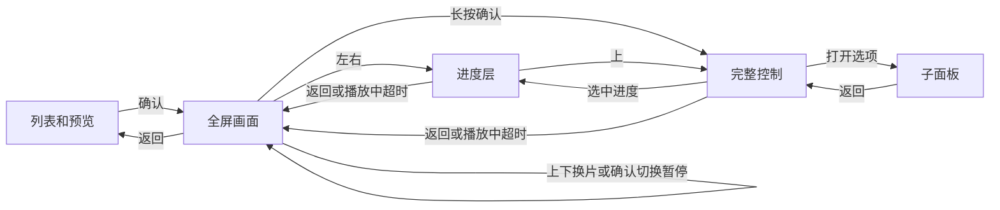

# Apple TV 沉浸式播放交互方案

以哔哩哔哩官方安卓 TV 版的个人推荐页为基准。列表聚焦后预览，确认进全屏。全屏里确认暂停或继续，上下换片，左右定位。返回逐层收起，最终回到当前卡片。Apple TV 用长按确认代替安卓独立菜单键来打开播放控制。

一期从「TV推荐」的普通投稿验收。「推荐」「关注」打开沉浸模式后复用相同的全屏键位。经典视频详情和全屏点播、直播、投屏各走现有入口。

## 安卓 TV 版的交互依据

附件是「云视听小电视」`com.xiaodianshi.tv.yst`，版本 `1.8.9`，`versionCode 108900`。2026-11-07 从官网 TV 入口取得的 APK 与附件逐字节一致，SHA-256 为 `73229ae195f45cdbfd4577b81962a4b4c9345a36abcd846e00dbc0647c127ef2`。以下行为来自该包的资源和按键调用链。包内有按内容类型、设置和服务端实验分组的分支，真机上的首按定位细节、自动全屏触发条件及面板时序待复核。 [哔哩哔哩下载中心](https://app.bilibili.com/index.html) · [官方 TV 安装包](https://dl.hdslb.com/mobile/latest/android_tv_yst/iBiliTV-master.apk)

| 场景 | 安卓 1.8.9 包内行为 | 核对位置 |
| --- | --- | --- |
| 推荐页 | 上下切卡，满足自动播放条件时预览当前项，选中卡片按确认进入全屏。个人推荐页还有闲置后收起列表进入全屏的路径。普通卡片的包内回退值为 **10 秒**，由配置覆盖，并受页面可见和列表状态限制。 | `IndividuationFragment` 的 `onItemClick`、`delayHideTopLayer`、`W2`、`J3`，`UtilsKt.getPrimaryListHideTime` |
| 全屏、控制收起 | ↑ 上一个，↓ 下一个。播放器先消费按键，未消费时才由全屏队列处理。一次按住通常只切一次。可切分集时优先尝试当前内容的上一 P／下一 P 或上一集／下一集，再交给外层 Feed。 | `PlayerKeyEventDelegate.dispatchKeyEvent`、`switchPrev`、`switchNext`，`unite_guide_switch_video` |
| 确认与菜单 | 画面上的短按确认在播放和暂停之间切换。独立菜单键唤起控制。控件有焦点时，方向键用于面板内导航，短按确认激活焦点项。 | `video/unite/l` 的 `w0`、`O0`、`p0`、`H0`、`K0`，`unite_guide_controller` |
| 左右定位 | 左右可唤起进度控件并进入快退、快进。普通进度控件的基础步长为 **10 秒**，可按配置或操作阶段调整。进度控件有松键和确认提交分支。 | `PlayerUniteSeekBarSupport` 的 `onKeyDown`、`onKeyUp`、`x`，`seek_tip` |
| 返回 | 优先交给控制层和子面板消费，剩余的返回事件由全屏入口处理。个人推荐页退回列表时按当前播放项同步滚动和焦点。独立播放页及部分连续剧路径另有二次返回策略。 | `video/unite/l.p0`、`IndividuationFragment.k2` 和 `J3`、`VideoSecondaryController.onBackFullScreen` |
| 长按与播完 | 长按确认有临时 2× 和三连分支，受实验组、偏好和内容支持影响。播完有同合集续播与 Feed 自动下一条两条路径，后者受 `isAutoNext` 控制。 | `PlayerKeyEventDelegate.tripleHandleKey`、`PlayControl186Config`、`IndividuationFragment.onPlayNext` |

## 现有 tvOS 的主要差异

代码基线 `1fb63f7`。

- 浏览页已有聚焦预览、确认进入 `.feedFlow`、从同条预览进度起播和退出回焦。首期沿用这套列表与队列入口。 [FeedFlowBrowserViewController.swift](../BilibiliLive/Module/ViewController/FeedFlowBrowserViewController.swift#L491) · [全屏入口与回焦](../BilibiliLive/Module/ViewController/FeedFlowBrowserViewController.swift#L656)
- 裸画面已经支持上下换片、左右 ±10 秒。播放中按确认会短暂停再续播，以唤出 AVKit 控制条。控制条打开后，按键交给 AVKit。何时收回按键还依赖可见性回调、兜底计时器和系统视图类名。 [VideoPlayerViewController.swift](../BilibiliLive/Component/Video/VideoPlayerViewController.swift#L468)
- 系统信息面板里聚焦「上一条／下一条」就可能触发换片。目标交互在用户确认后执行。自然播完和手动换片目前可分别推进同一个队列，且当前播完处理未读取「连续播放」开关。 [焦点触发逻辑](../BilibiliLive/Component/Video/VideoPlayerViewController.swift#L738) · [VideoPlayListPlugin.swift](../BilibiliLive/Component/Video/Plugins/VideoPlayListPlugin.swift#L84)

## Apple TV 的目标操作

全屏画面优先给视频。暂停时显示一个被动的暂停标记，仍按裸画面键位操作。左右唤出的进度层只显示时间、进度和目标点。完整控制层在底部显示标题、进度和播放操作，相关视频、分集或设置用独立子面板。首次全屏给一条短提示「↑↓ 换视频 · ←→ 调进度 · 长按确认打开播放控制」。

| 当前层 | ↑ / ↓ | ← / → | 短按确认 | 返回 |
| --- | --- | --- | --- | --- |
| 浏览列表 | 移动卡片焦点。焦点稳定后预览选中项 | 按列表现有焦点规则 | 全屏播放选中项。从同一条预览的有效位置接播 | 回到浏览入口的上一层 |
| 全屏画面（播放或暂停） | 上一条／下一条。每次独立按压最多换一条 | 打开进度层，同时将目标点后退／前进 10 秒 | 播放中暂停，暂停中继续。缓冲期间切换用户的播放意图 | 退出全屏，回到当前 Feed 卡片 |
| 进度层 | ↑ 提交待处理位置，切换到完整控制。↓ 留在进度层 | 点按逐步调整。按住连续调整目标点，松手统一提交 | 有待提交的位置时提交。其余情况切换播放／暂停 | 取消尚未提交的定位，回全屏画面。已提交的位置保留 |
| 完整控制 | 在进度、操作行和可用的内容入口间移动 | 在当前行移动焦点 | 执行焦点项，打开子面板，或切换到进度层 | 回全屏画面 |
| 子面板／系统弹窗 | 面板内焦点 | 面板内焦点 | 执行焦点项 | 关当前层，回到触发它的控件 |

- 全屏画面长按确认直接打开完整控制，短按和长按互斥。播放／暂停专键在画面和完整控制层切换播放意图。定位中按该键先提交目标点，再执行一次播放／暂停。系统弹窗拥有自己的输入。Siri Remote 的返回键用于逐层返回，TV／Home 交给系统。安卓长按确认的临时倍速和三连单独排期。 [Apple 对方向键遥控器的说明](https://developer.apple.com/news/?id=33cpm46r)
- 完整控制初始聚焦播放／暂停，首屏提供进度、清晰度、弹幕和倍速。详情、相关视频、博主视频、互动及其它当前视频可用项从控制层进入。焦点移动只更新高亮。进度层和完整控制互相切换，返回时一步回到画面。播放时，进度层空闲约 **3 秒**收起，完整控制约 **10 秒**收起。这是 tvOS 草案参数。正在定位、暂停、浏览子面板或弹窗时保留当前层。
- 定位以当前条目的可定位区间为边界，媒体就绪后才提交。切片和离开全屏都结束当前的定位交互。手动换片后从新条目的有效续播点开始播放。返回落到最后实际播放的 Feed 卡片。相关视频若临时跳出 Feed，返回仍落到发起跳转的卡片。停在第一条按 ↑ 时给轻反馈。到已加载的最后一条按 ↓ 时合并分页请求，加载成功再前进，确实到底时保留当前画面并提示。
- 自然播完和遥控换片走同一套队列。默认使用现有「连续播放」偏好决定自然结束后是否前进，循环只在确认队列结束时按现有开关处理。用户正在操作面板时先停在已播完状态，提供「重播」和可用的「下一条」。播放异常沿用自动重试和手动重试、跳过、返回，避免错误条目连续跳过整屏。

## tvOS 实现落点

1. **只给 `.feedFlow` 加状态化的按键路由。** 保留 `AVPlayerViewController`、现有播放器插件、DASH、历史和预缓冲。沉浸全屏用自有 UIKit 控件承接进度和完整控制。普通播放继续使用 AVKit 控制。面板可见性和焦点由本层持有，移除沉浸路径对短暂停续播和 AVKit 私有视图 Hook 的依赖。弹窗、控件、裸画面按从内到外的顺序消费事件。 [播放器容器](../BilibiliLive/Component/Player/CommonPlayerViewController.swift#L110) · [Apple AVKit 播放控制文档](https://developer.apple.com/documentation/avkit/customizing-the-tvos-playback-experience)
2. **复用现有动作和设置。** 从画质、弹幕、倍速和列表插件共享动作与选中状态。复用 `VideoPlayerInfoTabsPlugin` 背后的相关视频、博主和互动界面。主控制行用现有 tvOS 焦点控件，展开时明确设置默认焦点，关闭时恢复原焦点。定稿前在真机确认 Siri、专用播放键、字幕、画中画以及 VoiceOver 的可达性。 [播放器插件装配](../BilibiliLive/Component/Video/VideoPlayerViewModel.swift#L367) · [信息页插件](../BilibiliLive/Component/Video/Plugins/VideoPlayerInfoTabsPlugin.swift#L36)
3. **只让一个路径提交队列切换。** `VideoSequenceProvider` 继续管理顺序和分页。已有目标时，独立按压逐次推进目标位置，取消过期加载，只有最后接受的目标能更新封面、播放器和焦点。末尾分页期间保持一个待处理请求。结束通知、加载、seek 和自动收起定时器按播放代次失效。同一条的自然结束与手动切换交错时，手动输入优先。当前 `moveNext()` 跨两次 `await`，需要避免共享索引被重复推进。 [队列逻辑](../BilibiliLive/Component/Video/VideoPlayerViewController.swift#L104) · [已有加载代次](../BilibiliLive/Component/Video/VideoPlayerViewModel.swift#L79)
4. **按实际播放项保存进度。** 进出全屏和换片时，从实际绑定的 `AVPlayerItem` 保存位置，按已解析的 `aid + cid` 或 `epid` 匹配。列表回焦另用来源卡片 ID。缓存失效重载沿用当前位置和用户的暂停意图。预览和全屏交接时先停旧声音，目标首帧可见再去封面。 [续播与换片](../BilibiliLive/Component/Video/VideoPlayerViewModel.swift#L233) · [预览转全屏](../BilibiliLive/Module/ViewController/FeedFlowBrowserViewController.swift#L697)

## CDN 有效期与卡顿恢复

### 安卓点播如何处理

- 官方 1.8.9 的 `CachedSource` 支持按年龄淘汰。已核对的普通点播和 Feed 预热调用传 `-1`，关闭了这一层的计时。媒体缓存会检查预热媒体项是否有效、是否已取用，并在资源脱离播放器容器时清理。依据是 `MediaCacheManager.buildCacheSource`、`getCachedSource` 和预热解析回调。 [官方 TV 安装包](https://dl.hdslb.com/mobile/latest/android_tv_yst/iBiliTV-master.apk)
- `AssetUpdateReason` 把 HTTP 响应无效、网络错误和网络变化分别传给资源更新逻辑。点播处理器 `NormalVideoPlayHandler.obtainMediaResourceSync` 会强制重取，禁用预下发播放串，保留画质和格式上下文。HTTP 响应无效或收到 403／404 时还会切换安全连接参数。这里能确认 Java 层的恢复路径，原生播放器内部的签名检查和实际触发频率仍需运行态验证。
- `MainPlayDelegate` 给 Feed 配置了向前一条或两条的预取策略。触发点可按配置选择首帧、当前视频可播缓冲或接近播完。播放器将只解析地址和实际预缓冲媒体分开，并给预缓冲设置优先级及上限。依据是 `IVideoPreloadProvider`、`IPreloadNextProvider` 和 `IMediaPreloadStrategy`。

### tvOS 看到的现象

2026-11-07 匿名请求两条公开 UGC 的 Web DASH，返回的 30 个音视频主备地址都带十进制 Unix 秒 `deadline`，与响应时间相差约 **120 分钟**。这是这两条 Web 样本的期限，其他渠道、轨道和 CDN 候选需按各自返回值处理。 [项目使用的点播请求](../BilibiliLive/Request/WebRequest.swift#L496)

同日在一台 Apple TV 4K 上读取「影音」1.0 build 7 的两份日志。**18:04** 左右分片索引请求密集失败，18:04:57 播放位置仍在 **0 秒**，播放器换节点重建，18:05:12 重试耗尽。该时段还有两次接手预缓冲播放器时报告 **0.0 秒**。日志未保留这些索引失败的 HTTP 状态或地址余期，故能定位到切片后的起播失败，具体是过期、请求失败还是索引解析失败仍待区分。build 7 的日志与当前源码的缺口分别记录。

| 当前实现 | 对播放的影响 |
| --- | --- |
| 播放上下文按取回后 30 分钟淘汰，预热资源按准备完成后 20 分钟淘汰，前台恢复也用 30 分钟门槛。两个缓存独立计时。 | 缓存年龄与地址签名余期可能错开。预热播放器也可能持有上一批地址。 [地址缓存](../BilibiliLive/Component/Video/PlayContextCache.swift#L58) · [预热缓存](../BilibiliLive/Component/Video/PlayerMediaWarmup.swift#L122) · [前台恢复](../BilibiliLive/Component/Video/VideoPlayerViewController.swift#L301) |
| 冷起播的直连路径先逐个测候选，每个读 256 KB，再准备媒体索引。测速只检查 Alamofire 序列化结果。 | 慢候选挡在起播前。带响应体的 403／404 可能参与测速排名。起播看门狗在装上 `AVPlayerItem` 后才启动，前面的取流和索引耗时需要单独计量。 [CDNDiagnostics.swift](../BilibiliLive/Component/Player/CDNDiagnostics.swift#L37) · [装入播放器](../BilibiliLive/Component/Video/Plugins/BVideoPlayPlugin.swift#L707) · [Alamofire 响应校验](https://github.com/Alamofire/Alamofire/blob/master/Documentation/Usage.md#response-validation) |
| 预览先等邻居地址，再装当前播放器。全屏先给前后条目准备索引，达到一次 4 秒缓冲门槛后，最多给后四条各预缓冲 15 秒。 | 邻居请求会延长预览首帧，且全屏低缓冲后仍可能继续下载邻居媒体。接手预热资源时需要确认目标起播点附近真有可播放的数据。 [列表预览](../BilibiliLive/Module/ViewController/FeedFlowBrowserViewController.swift#L491) · [缓冲门槛](../BilibiliLive/Component/Video/VideoPlayerViewController.swift#L250) · [后续预缓冲](../BilibiliLive/Component/Video/VideoPlayerViewModel.swift#L327) |
| 起播超时、播放中换节点和多 CDN 回退直连都可用同一份 `playData.videoPlayURLInfo` 重建。 | 同批主备地址都失效时，换节点会重复用旧签名。多 CDN 下载器虽记录上游 HTTP 状态，本地代理一旦发出 206，只能截断失败响应，恢复逻辑需要从下载器直接接收原始原因。 [起播重建](../BilibiliLive/Component/Video/Plugins/BVideoPlayPlugin.swift#L819) · [上游 Range 响应](../BilibiliLive/Component/Player/MediaRangeDownloader.swift#L993) · [本地代理](../BilibiliLive/Component/Player/BilibiliVideoResourceLoaderDelegate.swift#L749) |

### 实现顺序

1. **先让起播有可追踪的时限。** 测速和 SIDX 复用现有 Range 校验思路，要求 206、匹配的 `Content-Range` 以及合理的字节数。保留真实 HTTP 状态，分开记录请求超时和索引解析失败。默认先用 API 候选顺序或当前网络近期成功的节点，请求索引失败时有界试备选。自动测速移出首帧的必经路径，保留手动测速。分别记录取流、测速、索引、装载和首帧的耗时。
2. **让地址缓存和预热共享同一批地址的身份。** 对已验证格式的 URL 逐个读取 `deadline`。暂用 **60 秒**作为提前刷新窗口，未知期限仍用 30 分钟缓存年龄兜底。选流和起播时分别检查所需视频及音频候选，有可用备选就继续用，缺少可用地址才合并请求新的 playurl。进入全屏、取预热、前台恢复和定位前复检。预热资源继承生成它的地址批次与期限，过期或被替换即释放，对同一内容及请求选项合并刷新。保留列表、详情和用户选择的档位。
3. **按失败原因恢复当前条目。** 地址到期、CDN 返回 403／404 且同档无可用备选时，针对当前条目强制刷新一次。普通超时或 5xx 优先走短暂等待、同档备线及自动档降码率。缓冲充足但掉帧时单独查解码、HDR 和输出切换。直连从 AVPlayer 错误日志补证据，代理从上游下载器回传错误。恢复任务按播放代次合并并校验提交，守住最新进度、暂停意图和用户选项。当前画面还能播时先准备新资源，切换时从原位置续上。 [AVPlayerItem 错误日志](https://developer.apple.com/documentation/avfoundation/avplayeritemerrorlogevent) · [AVPlayer 等待状态](https://developer.apple.com/documentation/avfoundation/avplayer/timecontrolstatus-swift.property)
4. **当前视频优先。** 列表聚焦后先启动当前预览。邻居先取地址，当前条首帧出来并有连续可播缓冲后，先只给下一条下载少量起播媒体。每次继续预缓冲前重新检查当前播放点所在的连续区间，缓冲见底、定位、暂停或换片时停止邻居下载。真机对照「下一条少量」和现有「四条各 15 秒」的首帧及卡顿数据，再定预缓冲预算。 [AVPlayerItem 缓冲区间](https://developer.apple.com/documentation/avfoundation/avplayeritem/loadedtimeranges)

验收覆盖四条路径。用可控响应制造已过期音轨、主节点 403 但备节点 206、全节点拒绝、长尾超时，确认同一批失败最多主动刷新一次，原进度和暂停意图正确恢复。用同一台 Apple TV、相同画质和网络对照冷起播、换片、定位和待机恢复，分别记录首帧耗时、重缓冲次数及总时长、掉帧与预热命中的实际缓冲秒数。日志记录主机、HTTP 状态和期限余量，完整签名地址留在请求内部。

## 实现顺序与验收

**一期。** 用同版 Android TV 录一条普通投稿从列表到全屏再返回的完整路径，记录设备、入口和设置。用首次左右键、长按松手、面板中的上下键和逐层返回确定验收口径。tvOS 在「TV推荐」打通表里的基础键位、续播和边界处理，再让「推荐」「关注」复用。用 tvOS 模拟器走流程，用 Siri Remote 真机验收点击、触控、按住、返回和专用播放键。

| 验收场景 | 通过标准 |
| --- | --- |
| 聚焦 A 预览，确认进入全屏 | A 从有效预览位置接播，交接时只有一路声音 |
| 裸画面短按确认两次，再长按 | 第一次保持暂停，第二次恢复。长按只打开控制，播放状态稳定 |
| 裸画面连续按右，接着打开面板 | 进度层显示目标时间。松手提交一次。面板中的 ↑↓ 移焦，当前视频保持 |
| 控制层 → 设置 → 连按返回 | 设置先关闭，焦点回到入口。再收起控制，最后退出全屏并回焦 |
| A→B→C，故意让 B 的响应晚于 C | 最终画面、标题、弹幕和回焦都对应 C。回到 A 从 A 的记录继续 |
| 按住 ↓，从第一条按 ↑，末尾分页失败，切片中按返回 | 单次按住只换一条。首项和末尾反馈可见。退出后旧回调无法重新起播 |
| 自然播完与按 ↓ 同时发生，切片后恢复网络 | 队列只推进一次。恢复后播放位置和暂停意图对应目标条目 |
| 画质、字幕、弹幕、倍速、相关视频，及普通播放器入口 | 沉浸模式各项操作可达，经典播放器的系统遥控行为通过回归 |

**二期。** 对照同版 Android TV 的多 P、合集与番剧，补齐分 P／集数优先换片。测列表空闲多久会进入全屏、返回后会否再次自动进入，用实测定「TV推荐」的启用条件，包内 10 秒作为起点。临时倍速单独定入口，避免与 tvOS 长按确认打开控制冲突。
